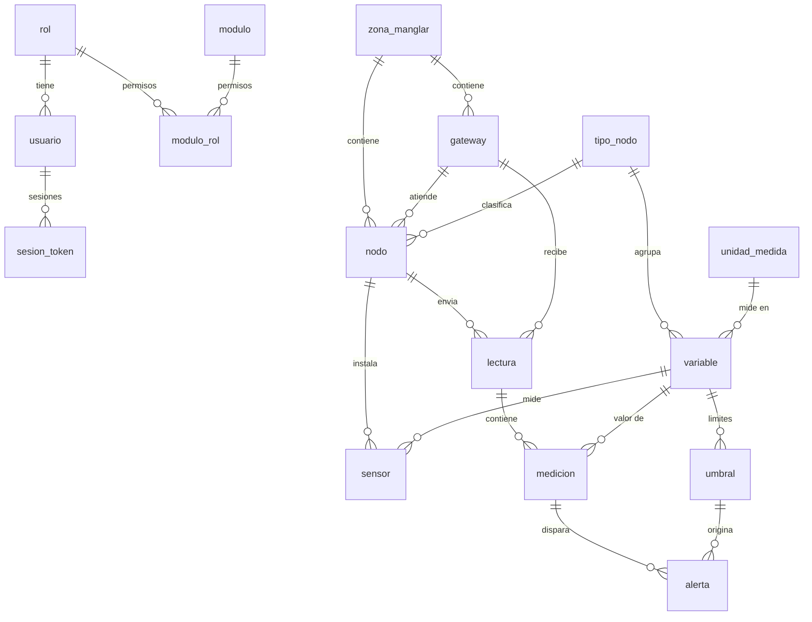

# Modelo de datos

## Base principal (PostgreSQL): 16 tablas

Todas las tablas tienen `id` (llave primaria), `estado` (BOOLEAN, TRUE por defecto; FALSE = eliminado logicamente desde la API), `creado` (DEFAULT now()) y `actualizado` (mantenido por el trigger `trg_actualizado`).

| Grupo | Tabla | Campos únicos |
|---|---|---|
| Seguridad | `rol` | nombre |
| Seguridad | `usuario` | username, email |
| Seguridad | `modulo` | nombre, ruta |
| Seguridad | `modulo_rol` (moduloxrol) | (rol_id, modulo_id) |
| Seguridad | `sesion_token` | jti |
| Infraestructura | `zona_manglar` | nombre |
| Infraestructura | `gateway` | codigo, api_key_hash |
| Infraestructura | `tipo_nodo` | codigo |
| Infraestructura | `nodo` | codigo |
| Catalogos | `unidad_medida` | simbolo |
| Catalogos | `variable` | codigo |
| Catalogos | `sensor` | (nodo_id, variable_id, modelo) |
| Datos | `lectura` | - |
| Datos | `medicion` | (lectura_id, variable_id) |
| Alertas | `umbral` | (variable_id, nivel) |
| Alertas | `alerta` | (medicion_id, umbral_id) |

### Normalizacion
- **1FN:** no hay grupos repetidos. El diseno anterior tenía una columna por sensor (la mayoría nula segun el tipo de nodo); ahora cada valor medido es una fila de `medicion`.
- **2FN y 3FN:** los datos del nodo, del gateway, de la variable y de la unidad viven en su propia tabla y se referencian por llave foránea; ninguna columna depende de otra que no sea la llave. Los permisos se separan en `modulo_rol` (relación muchos a muchos entre rol y módulo).
- Agregar un sensor nuevo (por ejemplo salinidad) solo requiere insertar una fila en `variable`; no cambia el esquema.

## Base auxiliar (MySQL): 4 tablas

Con los mismos tres campos de auditoria (`estado` TINYINT, `creado`, `actualizado` con `ON UPDATE CURRENT_TIMESTAMP`).

| Tabla | Función | Campos únicos |
|---|---|---|
| `categoria_conocimiento` | Agrupa el conocimiento del chatbot | nombre |
| `referencia_variable` | Ficha de cada variable: descripción, uso y rango normal | codigo_variable |
| `conocimiento_chatbot` | Preguntas frecuentes y respuestas | pregunta |
| `consulta_chatbot` | Bitacora de lo que se pregunta al chatbot | - |

`referencia_variable.codigo_variable` coincide con `variable.codigo` de la base principal, de modo que las dos bases se corresponden sin necesidad de una llave foránea entre motores distintos.

## Ámbitos y riego (migración 04)

Archivo: `db/principal/04_ambitos_y_riego.sql` (idempotente; en un despliegue existente se aplica con `scripts/migrar_db.sh`).

| Tabla | Propósito |
|---|---|
| `ambito` | Dominio de monitoreo: MANGLAR, VIVERO, RIEGO. Un ámbito nuevo es una fila nueva |
| `variable_alias` | Nombres con que los nodos reportan cada variable; reemplaza el diccionario fijo de la ingesta |
| `zona_riego` | Zona regada: modo (`AUTO`, `PROGRAMADO`, `MANUAL`, `APAGADO`), sensor que decide, histéresis de humedad y límites (duración máxima, descanso, límite diario) |
| `actuador` | Válvula motorizada o bomba, con su última posición reportada |
| `programa_riego` | Horarios de riego programado por zona |
| `comando_riego` | Cola de órdenes del panel al controlador central, con acuse (`PENDIENTE`, `ENVIADO`, `EJECUTADO`, `FALLIDO`, `CANCELADO`) |
| `evento_riego` | Bitácora de riegos realizados |

Cambios en tablas existentes: `nodo.ambito_id` (los nodos previos quedan en MANGLAR). Nuevos tipos de nodo (`RIEGO`), unidades (`ug/m3`, `V`, `L/min`), variables (`water_temperature`, `soil_temperature`, `co2`, `pm1`, `pm2_5`, `pm10`, `tank_level`, `pump_state`, `flow_rate`, `battery_voltage`, `battery_percent`), sus umbrales, módulos y permisos por rol. Todas las tablas nuevas llevan `estado`, `creado`, `actualizado` y el trigger de auditoría.

### Cómo agregar un módulo nuevo
1. Migración SQL con sus tablas, su fila en `modulo` y permisos en `modulo_rol`.
2. Router y/o lista de `Recurso` en la API, declarados en `app/registro.py`.
3. Si tiene vista propia en el dashboard, acoplar su panel en `dashboard.html` con una función como `ambitoDelPanel`.
